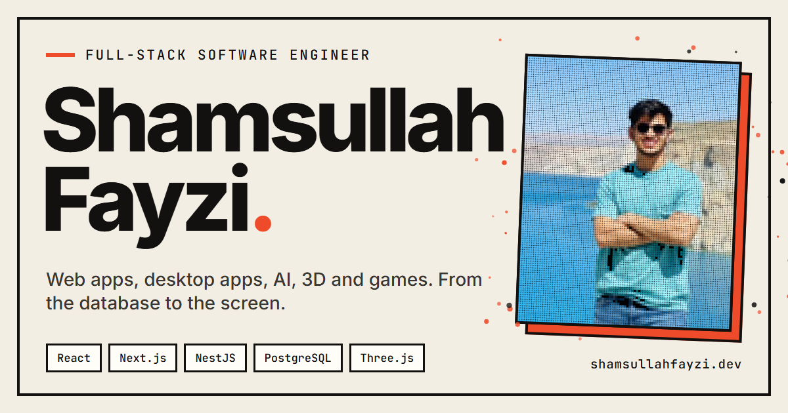

I'm a full-stack engineer. I take a product from the first conversation to a running deployment: database design, APIs, web and desktop interfaces, AI features and real-time 3D.

My best-known work is **[REDMARS](https://github.com/shamsullahfayzi/REDMARS)**, a bilingual, right-to-left hospital management system that runs on-premise, built with a Kabul hospital as design partner. It has a 47-table PostgreSQL schema, 30+ API modules, server-enforced permissions with a full audit trail, and allergy hard-blocks at prescribing. It was load-tested and ships as Docker containers with nightly backups and a verified restore.

**[shamsullahfayzi.dev](https://shamsullahfayzi.dev)** has the interactive versions of everything below.

## Selected work

| Project | What it is | Built with |
|---|---|---|
| [**REDMARS**](https://github.com/shamsullahfayzi/REDMARS) | Hospital management: registration, queues, consultation, lab, billing, pharmacy and reports | NestJS · Prisma · PostgreSQL · React 19 · TanStack Query · Docker |
| [**Solar Taxi Roof Sign**](https://github.com/shamsullahfayzi/solar-taxi-label) | Phone controller and a real-time 3D twin of a solar LED roof sign, with a Bluetooth layer that swaps between simulator and ESP32 hardware | React Three Fiber · Three.js · Zustand · Web Bluetooth |
| [**Zombie Typing**](https://github.com/shamsullahfayzi/zombie-typing) | Typing game with live WPM and accuracy, a leaderboard and a pooled audio engine | React 19 · Tailwind · Netlify |
| [**Zoya Clinic**](https://github.com/shamsullahfayzi/Zoya) | Patient registration and appointment tracking with role-guarded routes | Angular 16 · Angular Material · RxJS · JWT |
| [**Job Center**](https://github.com/shamsullahfayzi/job-center) | Two-sided job board for seekers and employers | React 19 · React Router · Tailwind |
| [**MusicMingle**](https://github.com/shamsullahfayzi/MusicMingle) | Event booking site with an admin back office | ASP.NET Core 9 · EF Core · Identity |

Client and team work with private code: a travel-agency system that cut manual processing time by 75% using Azure AI Document Intelligence and OCR, a face-recognition attendance system at 98% accuracy, an e-commerce platform, and a desktop prescription app used by several doctors.

## Stack

### Languages

  

### Frontend

  

### Backend

  

### Data

  

### DevOps & Tools

  

## Say hello

I'm open to full-stack roles and freelance projects.

[shamsullahfayzi.dev](https://shamsullahfayzi.dev) · [hello@shamsullahfayzi.dev](mailto:hello@shamsullahfayzi.dev) · [LinkedIn](https://www.linkedin.com/in/shamsullah-fayzi-b41884380/)
